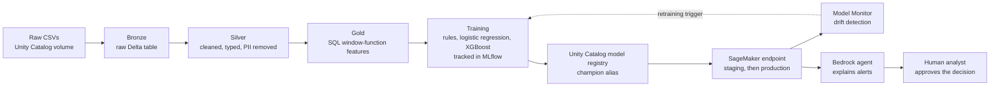

# Card Fraud Detection with MLOps and an AI Analyst Assistant

End-to-end card fraud detection on **Databricks**, **Amazon SageMaker** and **Amazon Bedrock**, with MLOps, CI/CD and a human-in-the-loop AI assistant that explains flagged transactions.

> **Status: in progress.** The data pipeline (M1) and model training (M2) are complete. Deployment on SageMaker (M3) is next. This README is updated as each milestone is completed.

---

## Results at a glance

On six held-out months (Jul – Dec 2020), the champion **XGBoost** model:

- caught **96%** of fraud (1,930 of 2,012 cases), against **52%** for a hand-written rule
- raised **42% fewer alerts** than the rule, with **43%** of alerts being real fraud (the rule: 14%)
- cut simulated fraud losses by **98%** compared with no model ($1.06M to $24K), and by **92%** compared with the rule

A fairness check found that genuine transactions from women were falsely flagged about **twice as often** as men's, even though gender is not a model input. This is documented below.

> The dataset is synthetic, so real-world performance would be lower. The meaningful result is the improvement over the rules and the simpler model, measured the same way on the same untouched months.

## The problem

Every card transaction needs a fraud decision in a fraction of a second. Fraud is rare (about **1 in 190** transactions in this dataset), so a useful system has to catch as much fraud as possible without blocking honest customers. Missing a fraud costs money; a false alarm costs customer trust.

This project builds the full system a bank would need: a governed data pipeline, a fraud model, automated deployment and monitoring, and an AI assistant that helps a human analyst decide what to do with each alert.

## Architecture



**CI/CD (planned):** GitHub Actions runs linting, unit tests, data validation and a model quality gate on every pull request. Merges to `main` build a Docker image, deploy to a staging endpoint, run smoke tests, and promote to production after manual approval.

## Tech stack

| Area | Tools |
|---|---|
| Data platform | Databricks (Free Edition), Delta Lake, Unity Catalog, Lakeflow Jobs, Git folders |
| Data processing | SQL (window functions), PySpark, pandas |
| Modelling | scikit-learn, XGBoost, SHAP (via XGBoost `pred_contribs`) |
| Experiment tracking and registry | MLflow tracking, Unity Catalog model registry |
| Deployment and monitoring | Amazon SageMaker (serverless endpoints, Model Monitor), Amazon S3, Amazon ECR, Docker |
| Generative AI | Amazon Bedrock (Anthropic Claude), tool-using agent with human approval |
| CI/CD | GitHub Actions, pytest, ruff, GitHub OIDC for AWS access |

## Data

[Credit Card Transactions Fraud Detection Dataset](https://www.kaggle.com/datasets/kartik2112/fraud-detection) (Kaggle). It is **synthetic**, so it contains no real customer data.

- **1,852,394** transactions across 2019–2020
- **9,651** frauds, a fraud rate of about **0.52%**
- Timestamps, merchants, spending categories, amounts, and customer and merchant locations

## Progress

| Milestone | Status |
|---|---|
| M0. Set up the workspace | ✅ Done |
| M1. Data pipeline on Databricks (bronze, silver, gold) | ✅ Done |
| M2. Train and compare models with MLflow | ✅ Done |
| M3. Deploy and monitor on SageMaker | 🟡 Next |
| M4. CI/CD with GitHub Actions | ⬜ Planned |
| M5. Fraud analyst agent on Bedrock | ⬜ Planned |
| M6. Polish, comparison and demo | ⬜ Planned |

---

## M1 · Data pipeline

The pipeline follows the Databricks **medallion architecture**. Each layer is a Delta table in Unity Catalog, under `workspace.fraud`.

| Layer | Table | What it holds |
|---|---|---|
| Bronze | `bronze_transactions` | The raw CSV rows, unchanged and stored as text, with the source file and load time |
| Silver | `silver_transactions` | Typed and de-duplicated, with customer names and street addresses removed, and data quality checks passed |
| Gold | `gold_features` | One row per transaction, with behavioural features for the model |

### Gold features

Every feature uses **only the card's earlier transactions**. Each time window ends at `1 PRECEDING`, so a transaction never contributes to its own baseline, and no future data leaks into training.

| Feature | Meaning |
|---|---|
| `txn_count_1h`, `txn_count_24h` | Transactions on the same card in the previous hour and 24 hours |
| `seconds_since_last_txn` | Gap since the card's previous transaction |
| `avg_amount_30d` | The card's average spend over the previous 30 days |
| `amount_vs_avg_30d` | This amount divided by that 30-day average |
| `hour_of_day`, `is_night` | Time of day, and whether it falls between 10pm and 6am |
| `customer_age` | Customer's age at the time of the transaction |
| `distance_km` | Haversine distance between the customer's home and the merchant |

`gender` is kept in the gold table only for fairness checks. It is not a model input.

### Orchestration and tests

- A **Lakeflow Job** (`fraud-data-pipeline`) runs `bronze_silver → gold_features` from the repo's **Databricks Git folder**. The gold task only starts if bronze and silver succeed. It triggers when a new CSV arrives and emails on failure. A full rebuild of 1.85 million rows takes about 1.5 minutes on serverless compute.
- The feature SQL lives in [`src/fraud/features.py`](src/fraud/features.py), and the gold notebook imports it, so the pipeline and the tests run the same code. [`tests/test_features.py`](tests/test_features.py) checks it on small hand-made data: a worked burst example, a card's first transaction, cards kept separate, and the night-time boundary. The tests caught an error in one of my own expected values during development.

### What the data showed

| Signal | Genuine | Fraud |
|---|---|---|
| Amount vs the card's 30-day average | 1.03× | **5.67×** |
| Share of transactions at night | 29.7% | **86.1%** |
| Transactions in the previous hour | 0.20 | **0.68** |
| Minutes since the previous transaction | 517 | **352** |
| Transactions in the previous 24 hours | 4.11 | 4.30 |
| Distance from home (km) | 76.1 | 76.3 |

Online shopping had the highest fraud rate (1.59%), and fraudulent online purchases averaged $998 against $72 for genuine ones. Fraud at petrol stations averaged just $12, consistent with criminals testing a stolen card with a small purchase. Distance from home carried no signal: in this synthetic data, merchant locations appear to be placed randomly around the customer.

---

## M2 · Models

### Method

- **Time-based split**, so the model is always tested on months it has never seen:

  | Split | Period | Transactions | Frauds | Fraud rate |
  |---|---|---|---|---|
  | Train | Jan 2019 – Mar 2020 | 1,097,693 | 6,343 | 0.58% |
  | Validation | Apr – Jun 2020 | 229,040 | 1,296 | 0.57% |
  | Test | Jul – Dec 2020 | 525,661 | 2,012 | 0.38% |

  The fraud rate falls in the test months, a small real example of drift that a random split would have hidden.
- **Three approaches**, each logged as an MLflow run: a **rules baseline** built from the strongest M1 signals (amount at least 3× the card's average, and at night or within a burst), **logistic regression**, and **XGBoost**.
- **Cost-based alert threshold.** Each model's threshold was chosen on the validation months to minimise cost, assuming a missed fraud loses its full amount and each false alarm costs $5 in analyst time and customer friction. The test months were used once, at the end.

### Results on the test months (Jul – Dec 2020)

| Approach | Recall | Precision | PR-AUC | Alerts | False alarms | Cost | Saving vs no model |
|---|---|---|---|---|---|---|---|
| Flag nothing | 0% | – | – | 0 | 0 | $1,060,050 | – |
| Rules baseline | 52.0% | 13.7% | – | 7,639 | 6,592 | $322,627 | $737,423 |
| Logistic regression | 80.7% | 11.0% | 0.18 | 14,706 | 13,083 | $111,257 | $948,793 |
| **XGBoost** (threshold 0.19) | **95.9%** | **43.3%** | **0.93** | **4,459** | **2,529** | **$24,161** | **$1,035,888** |

- **XGBoost wins clearly:** nearly twice the fraud caught by the rules, with 42% fewer alerts. Analysts would find a real fraud in about 1 of every 2.3 alerts, instead of 1 in 7.
- **Logistic regression struggles** because fraud depends on combinations and non-linear patterns (for example, fraud peaks late at night rather than rising steadily with the hour). One weight per input cannot express that; decision trees can.
- **The low threshold (0.19)** follows from the costs: a missed fraud costs far more than a $5 false alarm, so it pays to alert at a moderate score.

### What drives the model (SHAP)

Mean absolute SHAP value on 50,000 test transactions, top features:

| Rank | Feature | Mean \|SHAP\| |
|---|---|---|
| 1 | `log_amount` | 4.35 |
| 2 | `log_avg_amount_30d` | 1.31 |
| 3 | `hour_of_day` | 1.02 |
| 4 | `amount_vs_avg_30d` | 0.99 |
| 5 | `is_night` | 0.98 |
| 6 | `log_seconds_since_last_txn` | 0.77 |
| 7 | `customer_age` | 0.64 |
| 8 | `log_city_population` | 0.59 |

The model relies on the same signals the M1 analysis found: an unusual amount for the card, time of day, and quick succession. `txn_count_1h` ranks lower than its M1 averages suggested because `seconds_since_last_txn` carries much of the same information, and SHAP shares credit between overlapping features. Distance from home is near the bottom, as expected.

### Fairness check

Recall and false alarm rate (false alarms ÷ genuine transactions) on the test months, at the champion threshold:

| Group | Transactions | Frauds | Recall | False alarm rate |
|---|---|---|---|---|
| Women | 288,312 | 1,072 | 93.9% | **0.64%** |
| Men | 237,349 | 940 | 98.2% | **0.29%** |
| Under 30 | 88,586 | 309 | 99.0% | 0.59% |
| 30–44 | 175,663 | 608 | 94.2% | 0.59% |
| 45–59 | 144,804 | 570 | 94.7% | 0.50% |
| 60+ | 116,608 | 525 | 97.3% | 0.22% |

- **Women's genuine transactions are falsely flagged about 2.2 times as often as men's** (about 1,840 against 690 false alarms over six months), and slightly less fraud against women is caught. Gender is not a model input, so this is **proxy bias**: other features, such as spending categories and typical amounts, differ between groups in this data.
- **Customers under 60 are falsely flagged about 2.5 times as often as those over 60,** although fraud is caught well in every age group.
- Because the data is synthetic, the gaps partly reflect how it was generated. Before any real deployment, the next steps would be to find which features drive the gap, evaluate mitigations such as reweighting the training data with compliance input, record the result in a model card, and monitor these rates in production.

### Champion model

XGBoost is registered in the Unity Catalog model registry as **`workspace.fraud.fraud_detector`**, version 1, with the alias **`champion`**. The alert threshold (0.19) and test recall and precision are stored as tags on the version, because the scores are only meaningful together with the threshold. SHAP importance and the fairness tables are saved with the MLflow run. M3 deploys "the champion", so promoting a better model later only means moving the alias.

---

## Responsible AI and data handling

- Customer names and street addresses are removed at the silver layer; the model never sees them.
- Data quality checks stop the pipeline if there are duplicates, missing timestamps, invalid amounts or invalid labels.
- Gold features are point-in-time correct, so the model is trained only on information available when a transaction happens.
- Gender is excluded from the model and used only to measure fairness; the measured gaps are reported above rather than hidden.
- Planned: a model card, and human approval of every agent recommendation.

## Repository structure

```
notebooks/   Databricks notebooks: 01 bronze/silver, 02 gold features, 03 models
src/fraud/   Reusable, tested Python code (gold feature logic)
tests/       Unit tests, run with pytest and a local Spark session
deploy/      SageMaker inference code and Dockerfile (planned)
.github/     GitHub Actions workflows (planned)
```

## How to run

**On Databricks (Free Edition works):**

1. Download the dataset from Kaggle and upload `fraudTrain.csv` and `fraudTest.csv` to a Unity Catalog volume at `/Volumes/workspace/default/raw`.
2. Add this repository as a **Git folder** in the workspace.
3. Run `notebooks/01_bronze_silver` and `notebooks/02_gold_features` on serverless compute, or as a Lakeflow Job with `02` depending on `01`.
4. Run `notebooks/03_train_models`. It trains the models, logs them to the MLflow experiment `/Users/<you>/fraud-detection`, and registers the champion.

**Tests, locally (needs Python 3.10+ and Java 17+):**

```bash
pip install -r requirements-dev.txt
pytest
```

## Author

**Manaram Gnanasekera**, AI and machine learning engineer.
[LinkedIn](https://www.linkedin.com/in/manaram-gnanasekera-61bba9144/) · [Google Scholar](https://scholar.google.com/citations?user=xCLtDJcAAAAJ&hl=en)
