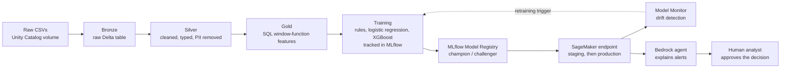

# Card Fraud Detection with MLOps and an AI Analyst Assistant

End-to-end card fraud detection on **Databricks**, **Amazon SageMaker** and **Amazon Bedrock**, with MLOps, CI/CD and a human-in-the-loop AI assistant that explains flagged transactions.

> **Status: in progress.** The data pipeline is being built (milestone M1). This README is updated as each milestone is completed.

---

## The problem

Every card transaction needs a fraud decision in a fraction of a second. Fraud is rare (about **1 in 190** transactions in this dataset), so a useful system has to catch as much fraud as possible without blocking honest customers. Missing a fraud costs money; a false alarm costs customer trust.

This project builds the full system a bank would need: a governed data pipeline, a fraud model, automated deployment and monitoring, and an AI assistant that helps a human analyst decide what to do with each alert.

## Architecture



**CI/CD:** GitHub Actions runs linting, unit tests, data validation and a model quality gate on every pull request. Merges to `main` build a Docker image, deploy to a staging endpoint, run smoke tests, and promote to production after manual approval.

## Tech stack

| Area | Tools |
|---|---|
| Data platform | Databricks (Free Edition), Delta Lake, Unity Catalog, Lakeflow Jobs |
| Data processing | SQL (window functions), PySpark, pandas |
| Modelling | scikit-learn, XGBoost / LightGBM, SHAP |
| Experiment tracking | MLflow tracking and Model Registry |
| Deployment and monitoring | Amazon SageMaker (serverless endpoints, Model Monitor), Amazon S3, Amazon ECR, Docker |
| Generative AI | Amazon Bedrock (Anthropic Claude), tool-using agent with human approval |
| CI/CD | GitHub Actions, pytest, ruff, GitHub OIDC for AWS access |

## Data

[Credit Card Transactions Fraud Detection Dataset](https://www.kaggle.com/datasets/kartik2112/fraud-detection) (Kaggle). It is **synthetic**, so it contains no real customer data.

- **1,852,394** transactions across 2019–2020
- **9,651** frauds, a fraud rate of about **0.52%**
- Timestamps, merchants, spending categories, amounts, and customer and merchant locations

## Progress

| Milestone | Status |
|---|---|
| M0. Set up the workspace | ✅ Done |
| M1. Data pipeline on Databricks (bronze, silver, gold) | 🟡 Bronze and silver done; gold features in progress |
| M2. Train and compare models with MLflow | ⬜ Planned |
| M3. Deploy and monitor on SageMaker | ⬜ Planned |
| M4. CI/CD with GitHub Actions | ⬜ Planned |
| M5. Fraud analyst agent on Bedrock | ⬜ Planned |
| M6. Polish, comparison and demo | ⬜ Planned |

## Findings so far

Exploring the silver table by spending category:

| Category | Fraud rate | Average fraud amount | Average normal amount |
|---|---|---|---|
| Online shopping (`shopping_net`) | 1.59% | $998 | $72 |
| Online miscellaneous (`misc_net`) | 1.30% | $799 | $71 |
| In-store grocery (`grocery_pos`) | 1.26% | $312 | $114 |
| Petrol and transport (`gas_transport`) | 0.41% | $12 | $64 |

1. **Online, card-not-present purchases carry the most fraud.**
2. **Fraud amounts are far larger than normal spending.** Online fraud averages about 14 times a normal online purchase, so "amount compared with this card's usual spend" should be a strong feature.
3. **Card testing shows up at petrol stations.** Fraudulent `gas_transport` transactions average just $12, consistent with criminals making a small test purchase before spending large amounts. This motivates time-window features such as transaction counts in the last hour.

## Responsible AI and data handling

- Customer names and street addresses are removed at the silver layer; the model never sees them.
- Data quality checks stop the pipeline if there are duplicates, missing timestamps, invalid amounts or invalid labels.
- Planned: fairness checks across age groups and gender, a model card, and human approval of every agent recommendation.

## Repository structure

```
notebooks/   Databricks notebooks, one per pipeline stage
src/         Reusable, tested Python code (planned)
tests/       Unit and data validation tests (planned)
deploy/      SageMaker inference code and Dockerfile (planned)
.github/     GitHub Actions workflows (planned)
```

## How to run

1. Download the dataset from Kaggle and upload `fraudTrain.csv` and `fraudTest.csv` to a Unity Catalog volume at `/Volumes/workspace/default/raw`.
2. Import `notebooks/01_bronze_silver.py` into a Databricks workspace (Free Edition works).
3. Attach serverless compute and run all cells. This creates `workspace.fraud.bronze_transactions` and `workspace.fraud.silver_transactions`.

## Author

**Manaram Gnanasekera**, AI and machine learning engineer.
[LinkedIn](https://www.linkedin.com/in/manaram-gnanasekera-61bba9144/) · [Google Scholar](https://scholar.google.com/citations?user=xCLtDJcAAAAJ&hl=en)# fraud-detection-mlops
End-to-end card fraud detection on Databricks, SageMaker and Bedrock, with MLOps, CI/CD and an AI analyst assistant.
