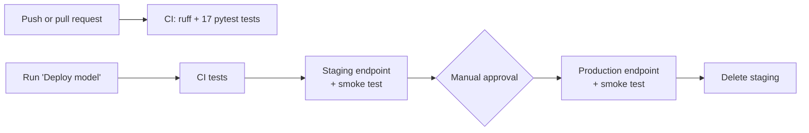

# Card Fraud Detection with MLOps and an AI Analyst Assistant

[](https://github.com/ManaramGnanasekera/fraud-detection-mlops/actions/workflows/ci.yml)

End-to-end card fraud detection on **Databricks**, **Amazon SageMaker** and **Amazon Bedrock**: a governed data pipeline, a tracked and explainable model, a serverless endpoint deployed through CI/CD with an approval gate, drift monitoring, and a human-in-the-loop AI assistant that explains every alert.

---

## Results at a glance

On six held-out months (Jul – Dec 2020), the champion **XGBoost** model:

- caught **96%** of fraud (1,930 of 2,012 cases), against **52%** for a hand-written rule
- raised **42% fewer alerts** than the rule, with **43%** of alerts being real fraud (the rule: 14%)
- cut simulated fraud losses by **98%** compared with no model ($1.06M to $24K), and by **92%** compared with the rule

In production:

- the **SageMaker endpoint** returns the same scores as Databricks on every sample transaction (10 of 10 within 0.0001), plus the top three reasons for each score
- the **Bedrock assistant** followed the alert policy and cited only real model reasons in **100%** of evaluated cases, and a human analyst makes every final decision
- every change is **linted and tested in CI**, and deployment runs **staging → smoke test → manual approval → production** with no AWS keys stored in GitHub

A fairness check found that genuine transactions from women were falsely flagged about **twice as often** as men's, even though gender is not a model input. This is documented in the M2 section and the [model card](MODEL_CARD.md).

> The dataset is synthetic, so real-world performance would be lower. The meaningful result is the improvement over the rules and the simpler model, measured the same way on the same untouched months.

## The problem

Every card transaction needs a fraud decision in a fraction of a second. Fraud is rare (about **1 in 190** transactions in this dataset), so a useful system has to catch as much fraud as possible without blocking honest customers. Missing a fraud costs money; a false alarm costs customer trust.

This project builds the full system a bank would need: a governed data pipeline, a fraud model, automated deployment and monitoring, and an AI assistant that helps a human analyst decide what to do with each alert.

## Architecture

```mermaid
flowchart LR
    A[Raw CSVs<br/>Unity Catalog volume] --> B[Bronze<br/>raw Delta table]
    B --> C[Silver<br/>cleaned, typed, PII removed]
    C --> D[Gold<br/>SQL window-function features]
    D --> E[Training<br/>rules, logistic regression, XGBoost<br/>tracked in MLflow]
    E --> F[Unity Catalog model registry<br/>champion alias]
    F --> X[Export to S3]
    X --> G[SageMaker serverless endpoint<br/>score + top reasons]
    G --> I[Bedrock agent<br/>Claude, tool use]
    I --> J[Human analyst<br/>approves or overrides]
    D --> H[Drift monitoring<br/>PSI, monthly]
    H -. retraining trigger .-> E
```





## Tech stack

| Area | Tools |
|---|---|
| Data platform | Databricks (Free Edition), Delta Lake, Unity Catalog, Lakeflow Jobs, Git folders |
| Data processing | SQL (window functions), PySpark, pandas |
| Modelling | scikit-learn, XGBoost, SHAP (via XGBoost `pred_contribs`) |
| Experiment tracking and registry | MLflow tracking, Unity Catalog model registry |
| Deployment | Amazon SageMaker (serverless endpoint, XGBoost framework container with a custom handler), Amazon S3 |
| Monitoring | Population Stability Index on the gold table, Delta report table |
| Generative AI | Amazon Bedrock Converse API with tool use, Claude Haiku 4.5 (Australian inference profile) |
| CI/CD | GitHub Actions, pytest, ruff, GitHub OIDC to AWS IAM, GitHub environments with required reviewers |

## Data

[Credit Card Transactions Fraud Detection Dataset](https://www.kaggle.com/datasets/kartik2112/fraud-detection) (Kaggle). It is **synthetic**, so it contains no real customer data.

- **1,852,394** transactions across 2019–2020
- **9,651** frauds, a fraud rate of about **0.52%**
- Timestamps, merchants, spending categories, amounts, and customer and merchant locations

## Progress

| Milestone | Status |
|---|---|
| M0. Set up the workspace | ✅ Done |
| M1. Data pipeline on Databricks (bronze, silver, gold) | ✅ Done |
| M2. Train and compare models with MLflow | ✅ Done |
| M3. Deploy on SageMaker and monitor drift | ✅ Done |
| M4. CI/CD with GitHub Actions | ✅ Done |
| M5. Fraud analyst agent on Bedrock | ✅ Done |
| M6. Polish, comparison and demo | ✅ Done |

---

## M1 · Data pipeline

The pipeline follows the Databricks **medallion architecture**. Each layer is a Delta table in Unity Catalog, under `workspace.fraud`.

| Layer | Table | What it holds |
|---|---|---|
| Bronze | `bronze_transactions` | The raw CSV rows, unchanged and stored as text, with the source file and load time |
| Silver | `silver_transactions` | Typed and de-duplicated, with customer names and street addresses removed, and data quality checks passed |
| Gold | `gold_features` | One row per transaction, with behavioural features for the model |

### Gold features

Every feature uses **only the card's earlier transactions**. Each time window ends at `1 PRECEDING`, so a transaction never contributes to its own baseline, and no future data leaks into training.

| Feature | Meaning |
|---|---|
| `txn_count_1h`, `txn_count_24h` | Transactions on the same card in the previous hour and 24 hours |
| `seconds_since_last_txn` | Gap since the card's previous transaction |
| `avg_amount_30d` | The card's average spend over the previous 30 days |
| `amount_vs_avg_30d` | This amount divided by that 30-day average |
| `hour_of_day`, `is_night` | Time of day, and whether it falls between 10pm and 6am |
| `customer_age` | Customer's age at the time of the transaction |
| `distance_km` | Haversine distance between the customer's home and the merchant |

`gender` is kept in the gold table only for fairness checks. It is not a model input.

### Orchestration and tests

- A **Lakeflow Job** (`fraud-data-pipeline`) runs `bronze_silver → gold_features` from the repo's **Databricks Git folder**. The gold task only starts if bronze and silver succeed. It triggers when a new CSV arrives and emails on failure. A full rebuild of 1.85 million rows takes about 1.5 minutes on serverless compute.
- The feature SQL lives in [`src/fraud/features.py`](src/fraud/features.py), and the gold notebook imports it, so the pipeline and the tests run the same code. [`tests/test_features.py`](tests/test_features.py) checks it on small hand-made data: a worked burst example, a card's first transaction, cards kept separate, and the night-time boundary. The tests caught an error in one of my own expected values during development.

### What the data showed

| Signal | Genuine | Fraud |
|---|---|---|
| Amount vs the card's 30-day average | 1.03× | **5.67×** |
| Share of transactions at night | 29.7% | **86.1%** |
| Transactions in the previous hour | 0.20 | **0.68** |
| Minutes since the previous transaction | 517 | **352** |
| Transactions in the previous 24 hours | 4.11 | 4.30 |
| Distance from home (km) | 76.1 | 76.3 |

Online shopping had the highest fraud rate (1.59%), and fraudulent online purchases averaged $998 against $72 for genuine ones. Fraud at petrol stations averaged just $12, consistent with criminals testing a stolen card with a small purchase. Distance from home carried no signal: in this synthetic data, merchant locations appear to be placed randomly around the customer.

---

## M2 · Models

### Method

- **Time-based split**, so the model is always tested on months it has never seen:

  | Split | Period | Transactions | Frauds | Fraud rate |
  |---|---|---|---|---|
  | Train | Jan 2019 – Mar 2020 | 1,097,693 | 6,343 | 0.58% |
  | Validation | Apr – Jun 2020 | 229,040 | 1,296 | 0.57% |
  | Test | Jul – Dec 2020 | 525,661 | 2,012 | 0.38% |

  The fraud rate falls in the test months, a small real example of drift that a random split would have hidden.
- **Three approaches**, each logged as an MLflow run: a **rules baseline** built from the strongest M1 signals (amount at least 3× the card's average, and at night or within a burst), **logistic regression**, and **XGBoost**.
- **Cost-based alert threshold.** Each model's threshold was chosen on the validation months to minimise cost, assuming a missed fraud loses its full amount and each false alarm costs $5 in analyst time and customer friction. The test months were used once, at the end.

### Results on the test months (Jul – Dec 2020)

| Approach | Recall | Precision | PR-AUC | Alerts | False alarms | Cost | Saving vs no model |
|---|---|---|---|---|---|---|---|
| Flag nothing | 0% | – | – | 0 | 0 | $1,060,050 | – |
| Rules baseline | 52.0% | 13.7% | – | 7,639 | 6,592 | $322,627 | $737,423 |
| Logistic regression | 80.7% | 11.0% | 0.18 | 14,706 | 13,083 | $111,257 | $948,793 |
| **XGBoost** (threshold 0.19) | **95.9%** | **43.3%** | **0.93** | **4,459** | **2,529** | **$24,161** | **$1,035,888** |

- **XGBoost wins clearly:** nearly twice the fraud caught by the rules, with 42% fewer alerts. Analysts would find a real fraud in about 1 of every 2.3 alerts, instead of 1 in 7.
- **Logistic regression struggles** because fraud depends on combinations and non-linear patterns (for example, fraud peaks late at night rather than rising steadily with the hour). One weight per input cannot express that; decision trees can.
- **The low threshold (0.19)** follows from the costs: a missed fraud costs far more than a $5 false alarm, so it pays to alert at a moderate score.

### What drives the model (SHAP)

Mean absolute SHAP value on 50,000 test transactions, top features:

| Rank | Feature | Mean \|SHAP\| |
|---|---|---|
| 1 | `log_amount` | 4.35 |
| 2 | `log_avg_amount_30d` | 1.31 |
| 3 | `hour_of_day` | 1.02 |
| 4 | `amount_vs_avg_30d` | 0.99 |
| 5 | `is_night` | 0.98 |
| 6 | `log_seconds_since_last_txn` | 0.77 |
| 7 | `customer_age` | 0.64 |
| 8 | `log_city_population` | 0.59 |

The model relies on the same signals the M1 analysis found: an unusual amount for the card, time of day, and quick succession. `txn_count_1h` ranks lower than its M1 averages suggested because `seconds_since_last_txn` carries much of the same information, and SHAP shares credit between overlapping features. Distance from home is near the bottom, as expected.

### Fairness check

Recall and false alarm rate (false alarms ÷ genuine transactions) on the test months, at the champion threshold:

| Group | Transactions | Frauds | Recall | False alarm rate |
|---|---|---|---|---|
| Women | 288,312 | 1,072 | 93.9% | **0.64%** |
| Men | 237,349 | 940 | 98.2% | **0.29%** |
| Under 30 | 88,586 | 309 | 99.0% | 0.59% |
| 30–44 | 175,663 | 608 | 94.2% | 0.59% |
| 45–59 | 144,804 | 570 | 94.7% | 0.50% |
| 60+ | 116,608 | 525 | 97.3% | 0.22% |

- **Women's genuine transactions are falsely flagged about 2.2 times as often as men's** (about 1,840 against 690 false alarms over six months), and slightly less fraud against women is caught. Gender is not a model input, so this is **proxy bias**: other features, such as spending categories and typical amounts, differ between groups in this data.
- **Customers under 60 are falsely flagged about 2.5 times as often as those over 60,** although fraud is caught well in every age group.
- Because the data is synthetic, the gaps partly reflect how it was generated. Before any real deployment, the next steps would be to find which features drive the gap, evaluate mitigations such as reweighting the training data with compliance input, record the result in a model card, and monitor these rates in production.

### Champion model

XGBoost is registered in the Unity Catalog model registry as **`workspace.fraud.fraud_detector`**, version 1, with the alias **`champion`**. The alert threshold (0.19) and test recall and precision are stored as tags on the version, because the scores are only meaningful together with the threshold. SHAP importance and the fairness tables are saved with the MLflow run. M3 deploys "the champion", so promoting a better model later only means moving the alias.

---

## M3 · Deployment on SageMaker and drift monitoring

### From registry to endpoint

1. [`notebooks/04_export_champion.py`](notebooks/04_export_champion.py) loads `fraud_detector@champion` from Unity Catalog and exports the XGBoost model, its metadata (input names, threshold, version) and 10 sample transactions with their Databricks scores.
2. [`deploy/deploy_endpoint.py`](deploy/deploy_endpoint.py) packages the model and deploys a **serverless SageMaker endpoint** (2 GB, max concurrency 2) using AWS's XGBoost 3.0 container with a custom handler, [`deploy/inference.py`](deploy/inference.py). `--replace` swaps an existing endpoint safely.
3. [`deploy/test_endpoint.py`](deploy/test_endpoint.py) sends the sample transactions to the endpoint and fails unless every score matches Databricks.

The handler rebuilds the 26 model inputs from raw gold features with exactly the same transformations as training, so there is no training-serving skew. A unit test checks this against the trained model.

```json
{
  "transaction_id": "888ca74a571ae8a64f09efa15333ed7a",
  "fraud_score": 0.9982,
  "flagged": true,
  "threshold": 0.19,
  "model_version": "1",
  "top_reasons": [{"feature": "category_gas_transport", "value": 1.0, "contribution": 3.1}, "..."]
}
```

`top_reasons` are the three largest positive SHAP contributions for that transaction, so every alert carries its own explanation.

| Check | Result |
|---|---|
| Endpoint scores vs Databricks | **10 / 10 match** (tolerance 0.0001) |
| Fraud cases flagged | 5 / 5 (scores 0.996 – 0.9999) |
| Genuine cases passed | 5 / 5 (scores ≤ 0.0012) |

**Why serverless:** fraud scoring for a portfolio demo has bursty, low traffic. Serverless costs nothing when idle, at the price of a cold start on the first request.

### Drift monitoring

SageMaker Model Monitor relies on data capture, which serverless endpoints do not support, and the features are built in the lakehouse anyway. So [`notebooks/05_drift_monitoring.py`](notebooks/05_drift_monitoring.py) measures drift on the gold table each month:

- **Population Stability Index (PSI)** for 10 numeric inputs, the spending category and the model's score, against the training period (Jan 2019 – Mar 2020)
- monthly fraud rate, alert volume and recall
- **retraining rule:** PSI above 0.25 on a watched input or the score, or monthly recall below 0.90
- results appended to the Delta table `workspace.fraud.drift_report`

**Results (Apr – Dec 2020, 9 monitored months):**

| PSI by month | Apr | May | Jun | Jul | Aug | Sep | Oct | Nov | **Dec** |
|---|---|---|---|---|---|---|---|---|---|
| `amount` | 0.000 | 0.000 | 0.000 | 0.000 | 0.000 | 0.000 | 0.000 | 0.000 | 0.000 |
| `amount_vs_avg_30d` | 0.002 | 0.002 | 0.003 | 0.003 | 0.006 | 0.002 | 0.002 | 0.006 | 0.004 |
| `customer_age` | 0.006 | 0.006 | 0.008 | 0.010 | 0.009 | 0.014 | 0.015 | 0.014 | 0.016 |
| `seconds_since_last_txn` | 0.009 | 0.003 | 0.020 | 0.011 | 0.018 | 0.006 | 0.010 | 0.006 | **0.213** |
| `txn_count_24h` | 0.035 | 0.017 | 0.036 | 0.020 | 0.026 | 0.018 | 0.044 | 0.007 | **0.595** |
| `fraud_score` | 0.002 | 0.001 | 0.001 | 0.000 | 0.000 | 0.003 | 0.003 | 0.000 | 0.040 |

All other inputs (`hour_of_day`, `category`, `city_population`, `distance_km`, `txn_count_1h`) stayed below 0.03 in every month.

| Month | Transactions | Fraud rate | Alert rate | Recall |
|---|---|---|---|---|
| Apr – Nov 2020 (range) | 66,892 – 88,759 | 0.37% – 0.71% | 0.88% – 1.25% | 94.3% – 98.5% |
| **Dec 2020** | **139,538** | **0.19%** | **0.59%** | **95.0%** |

- **Eight months were stable:** every input and the score stayed well below PSI 0.10.
- **December shifted sharply.** Transaction volume doubled with holiday shopping, so cards transacted far more often: `txn_count_24h` reached PSI **0.60** (significant) and `seconds_since_last_txn` **0.21** (moderate). The fraud rate also halved.
- **Decision: no retraining.** Neither shifted input is among the model's five most important, the score itself barely moved (PSI 0.04), and recall held at 95%. The rule correctly flagged the shift for investigation without triggering a needless retrain. A seasonal reference period, or a December-aware feature, would be the follow-up if the pattern repeats.

---

## M4 · CI/CD with GitHub Actions

### Continuous integration ([`ci.yml`](.github/workflows/ci.yml))

Every push and pull request runs **ruff** and **17 pytest tests** on a clean Ubuntu runner with Python 3.12 and Java 17:

| Test file | What it checks |
|---|---|
| `test_features.py` | Gold feature SQL on hand-made data (bursts, first transaction, separate cards, night boundary), using a local Spark session |
| `test_inference.py` | The SageMaker handler: input preparation matches training, scores match the trained model, JSON in and out, top reasons are the largest SHAP values, bad input is rejected |
| `test_agent.py` | The Bedrock agent loop with a fake Bedrock client: tool calls, policy check and faithfulness check |

CI earned its place early: the first run failed because scikit-learn was installed on my machine but missing from `requirements-dev.txt`. A clean environment caught what a local run hid.

### Continuous deployment ([`deploy.yml`](.github/workflows/deploy.yml))

Run manually from the Actions tab ("Deploy model"):

1. **Test:** reuses the CI workflow; nothing deploys if a test fails.
2. **Staging:** deploys `fraud-detector-staging` and runs the smoke test (scores must match Databricks).
3. **Approval:** the `production` GitHub environment requires a named reviewer to approve.
4. **Production:** replaces `fraud-detector`, runs the smoke test, then deletes the staging endpoint.

A full run takes about **12 minutes**, including the approval.

**No stored AWS keys.** GitHub Actions signs in to AWS with **OIDC**: GitHub issues a short-lived token, and an IAM role trusts only this repository. The role's trust policy matches GitHub's subject claim, which now includes the immutable owner and repository IDs:

```
repo:ManaramGnanasekera@222968163/fraud-detection-mlops@1433156399:*
```

The IAM console's GitHub wizard writes the older format without the IDs, which made every login fail with `Not authorized to perform sts:AssumeRoleWithWebIdentity`. CloudTrail's failed `AssumeRoleWithWebIdentity` events showed the exact subject GitHub sent, and the trust policy was corrected to match. The IDs are also safer: a deleted and re-created repository with the same name cannot reuse the role.

---

## M5 · Fraud analyst agent on Amazon Bedrock

[`agent/fraud_agent.py`](agent/fraud_agent.py) gives a fraud analyst a second opinion on each transaction. It uses the **Bedrock Converse API with tool use** and **Claude Haiku 4.5** through the Australian cross-region inference profile, so requests stay in Australian regions.

**Tools the model can call**

| Tool | What it does |
|---|---|
| `score_transaction` | Calls the SageMaker endpoint and returns the score, flag and top reasons |
| `get_card_activity` | Returns the card's recent behaviour, with the fraud label and any scores removed so the agent cannot cheat |

**Policy:** BLOCK if the score is at least 0.90, REVIEW if it is at least the model's threshold (0.19), otherwise ALLOW. The agent must reply in JSON with a recommendation, a summary and the features it cited.

**Guardrails checked in code on every reply:** the agent must have called the model, its recommendation must follow the policy for the actual score, and every cited feature must be one of the reasons the endpoint returned (no invented explanations).

**Human in the loop:** in `review` mode the analyst sees the recommendation and the checks, then approves or overrides. Every decision is logged with a timestamp to `decisions.jsonl` as an audit trail.

```
Transaction 888ca74a571ae8a64f09efa15333ed7a
  Model score: 0.998234 (threshold 0.19, version 1)
  Assistant recommends: BLOCK
  Why: The fraud score is 0.998, well above the 0.9 threshold for blocking. The transaction is flagged
       primarily due to a gas/transport category purchase at midnight (is_night=1), combined with an
       unusually small amount ($6.67) compared to this card's 30-day average of $99.80.
  Checks: policy ok, faithful ok

Analyst decision: [a]pprove, or type BLOCK / REVIEW / ALLOW to override: a
Logged: analyst decision BLOCK -> decisions.jsonl
```

This is the classic **card-testing** pattern: a tiny purchase at night to check that a stolen card works.

**Evaluation** (`evaluate` mode, 10 sample transactions, temperature 0):

| Check | Result |
|---|---|
| Valid JSON reply | 100% |
| Called the fraud model | 100% |
| Followed the alert policy | 100% |
| Cited only real model reasons | 100% |
| Agreed with the model's flag | 100% |

**Limitation:** the sample scores are clear-cut (near 0 or near 1). The real test is borderline scores near the threshold, which is the next evaluation to add.

---

## M6 · Lessons learned

- **Point-in-time features matter more than the model.** Ending every window at `1 PRECEDING` kept the current transaction out of its own baseline; without it, validation scores would have looked better and production worse.
- **Pick the threshold with costs, not 0.5.** The cost-based threshold (0.19) was what turned a good model into a big saving.
- **Test the serving code against the training code.** The parity test and the 10/10 endpoint match catch training-serving skew before it reaches customers.
- **Use the audit logs.** The OIDC failure looked like a correct policy until CloudTrail showed the real subject claim.
- **Keep the human in charge.** The assistant explains and recommends; it never decides, and its explanations are checked against the model's own reasons.

## Responsible AI and data handling

- Customer names and street addresses are removed at the silver layer; the model never sees them.
- Data quality checks stop the pipeline if there are duplicates, missing timestamps, invalid amounts or invalid labels.
- Gold features are point-in-time correct, so the model is trained only on information available when a transaction happens.
- Gender is excluded from the model and used only to measure fairness; the measured gaps are reported rather than hidden.
- Every endpoint score comes with its top reasons, and the agent may only cite those reasons.
- Every recommendation needs a human decision, and decisions are logged.
- Bedrock runs through the Australian inference profile, and CI/CD uses short-lived OIDC credentials instead of stored keys.
- The [model card](MODEL_CARD.md) records intended use, performance, fairness gaps, limitations and the retraining rule.

## Repository structure

```
notebooks/   Databricks notebooks: 01 bronze/silver, 02 gold features, 03 models,
             04 export champion to S3, 05 drift monitoring
src/fraud/   Reusable, tested Python code (gold feature logic)
deploy/      SageMaker handler, deploy / smoke-test / delete scripts
agent/       Bedrock fraud analyst agent (review and evaluate modes)
tests/       17 unit tests: features (local Spark), inference handler, agent
.github/     CI and CD workflows
MODEL_CARD.md
```

## How to run

**On Databricks (Free Edition works):**

1. Download the dataset from Kaggle and upload `fraudTrain.csv` and `fraudTest.csv` to a Unity Catalog volume at `/Volumes/workspace/default/raw`.
2. Add this repository as a **Git folder** in the workspace.
3. Run `notebooks/01_bronze_silver` and `notebooks/02_gold_features`, or as a Lakeflow Job with `02` depending on `01`.
4. Run `notebooks/03_train_models` to train, log to MLflow and register the champion.
5. Run `notebooks/04_export_champion`, then download the files from `/Volumes/workspace/fraud/exports` and upload them to S3 under `models/fraud_detector_v1/`. (Free Edition cannot reach AWS directly.)
6. Run `notebooks/05_drift_monitoring` for the drift report.

**On AWS (ap-southeast-2), for example in CloudShell:**

```bash
pip install "sagemaker>=2.230,<3" boto3
cd deploy
python3 deploy_endpoint.py --bucket <bucket> --role <sagemaker-execution-role-arn>
python3 test_endpoint.py --bucket <bucket>

cd ../agent   # needs Bedrock access to Claude Haiku 4.5
python3 fraud_agent.py --bucket <bucket> evaluate
python3 fraud_agent.py --bucket <bucket> review --transaction-id <id>

python3 ../deploy/delete_endpoint.py --endpoint-name fraud-detector   # stop charges
```

**CI/CD:** create the GitHub OIDC provider and a deploy role in IAM (trust policy as in M4), add repository variables `AWS_DEPLOY_ROLE_ARN`, `SAGEMAKER_EXECUTION_ROLE_ARN` and `S3_BUCKET`, create `staging` and `production` environments (production with a required reviewer), then run **Deploy model** from the Actions tab.

**Tests, locally (Python 3.10+ and Java 17+):**

```bash
pip install -r requirements-dev.txt
ruff check src tests deploy agent
pytest
```

## Author

**Manaram Gnanasekera**, AI and machine learning engineer.
[LinkedIn](https://www.linkedin.com/in/manaram-gnanasekera-61bba9144/) · [Google Scholar](https://scholar.google.com/citations?user=xCLtDJcAAAAJ&hl=en)
